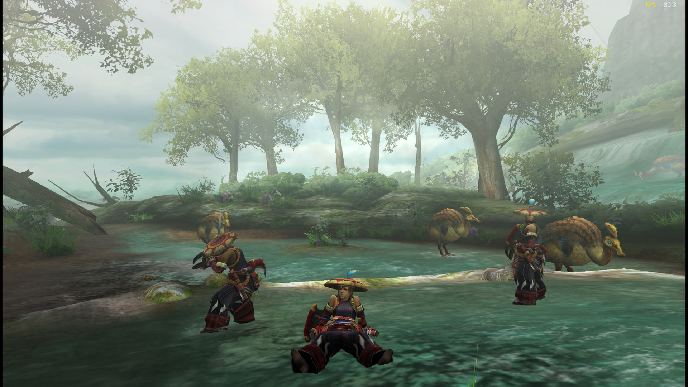

# MHP3rd PS5

**MHP3rd PS5** is an independent community project adapting [TeamGDB's Yakumo](https://github.com/TeamGDB/Yakumo) to run *Monster Hunter Portable 3rd HD Ver.* on PlayStation 5. The PS5 port is developed by **elaporta**. This repository contains original port sources, component build recipes, local preparation tools and installation documentation.

[View more PS5 screenshots](#screenshots)

**Build locally from source.** The installation assistant validates your inputs, obtains pinned public sources, builds the application and its existing permission payload, and prepares one private transfer folder. Follow [INSTALL.md](INSTALL.md).

## Features

- Native PS5 gameplay based on Yakumo.
- Internal resolution up to x6.
- 60-FPS presentation as the default profile.
- HD texture replacement support.
- PS5 controller mappings, including touchpad Hide HUD, R2 for Select and L2 hold for fast-forward.
- PS5 system keyboard input for hunter names and Guild Card text.
- In-game web settings menu, opened with L3+R3, for video, controls, audio and online preferences.
- Ad hoc online multiplayer, with reported cross-play with PPSSPP on PC and Android. Other PS5 and PPSSPP systems are expected pairings.
- Game audio with the corrected output level.

## In-game web settings

Press **L3 + R3 together while the game is running** to open its built-in settings page in the PS5 browser. The menu is available in English and Spanish, so you can configure the game without editing configuration files.

| Category | Options |
| --- | --- |
| Online | Enable multiplayer, set your nickname and ad hoc server, view the connection status and enable diagnostic logging. |
| Video | Internal resolution, presentation FPS, aspect ratio, HD textures, image/text filters and performance indicators. |
| Acceleration | Fast-forward mode and speed, plus faster loading. |
| Controls + camera | Confirm button, controller shortcuts, right-stick behavior, analog camera and axis inversion. |
| Audio | Volume and mute. |

Select **Save changes**, then close and restart the game to apply them. **Discard** clears unsaved edits; **Restore** resets the selected category in the draft, which you can then save.

## Screenshots

Captured on the user's PS5. Click an image link to open the 1920×1080 version.

[Forest clearing](photos/ps5-forest.jpg) · [Waterfall](photos/ps5-waterfall.jpg) · [Forest canopy](photos/ps5-forest-canopy.jpg) · [Gathering hall](photos/ps5-gathering-hall.jpg) · [Online party](photos/ps5-online-party.jpg) · [Online status](photos/ps5-online-status.jpg)

## Installation

See the [installation guide](INSTALL.md) for the local preparation assistant, file layout and PS5 transfer steps.

One command generates every application program and game-derived file locally from pinned public sources and your own inputs. Generated code, images, textures, saves and build results stay private under ignored `out/data/`. Keep `dependencies.lock.json`: it fixes the source revisions and download checksums needed by the assistant.

## Project identity

MHP3rd PS5 is not affiliated with, authorized by, sponsored by or endorsed by TeamGDB, CAPCOM or Sony. “MHP3rd PS5” identifies this independent compatibility project. Monster Hunter, Monster Hunter Portable 3rd HD Ver., PlayStation, PSP and related marks and game materials belong to their respective owners.

## Warranty and responsibility

The software is provided under its applicable licenses, including the warranty disclaimer and limitation of liability in GNU GPL version 3 or later for original MHP3rd PS5 code, to the extent permitted by applicable law. This notice does not grant rights to third-party material or remove obligations that cannot legally be waived. Users are responsible for supplying and using their own game files lawfully.

## Game files

This project does not distribute the game disc image, extracted game data, generated game code, game textures or saves. Users must supply game files from their own legally obtained copy and comply with the laws that apply to them. Separately licensed texture packs must be obtained and used under their own terms.

## Code and licenses

Original MHP3rd PS5 project code is licensed under **GNU GPL version 3 or later**; see [LICENSE](LICENSE). Yakumo is licensed separately under the **MIT License**. Other third-party components retain their own licenses and notices. See [Yakumo's MIT notice](LICENSES/Yakumo-MIT.txt) and the credits below.

The Yakumo license covers Yakumo's code and materials; it does not grant rights to the game or other third-party intellectual property.

## Credits

### Yakumo

MHP3rd PS5 builds on **[Yakumo](https://github.com/TeamGDB/Yakumo), the upstream project maintained by TeamGDB**, and the work of its contributors. The upstream MIT notice credits PSPRecomp contributors and Yakumo contributors; the original notice is preserved in [LICENSES/Yakumo-MIT.txt](LICENSES/Yakumo-MIT.txt).

This credit does not imply that TeamGDB or any Yakumo contributor is involved in, or endorses, MHP3rd PS5.

### HD texture packs

The separately maintained texture pack used during local testing is the [Enhanced HD Texture Pack](https://github.com/HolographicWings/Monster-Hunter-Portable-3rd-HD-Pack-Enhanced), maintained by **HolographicWings**. Its README credits the original pack work by **AFOOT, Darix, !-0 Kuña’i Ñakurutû (Tano), Effy and Stormie**, and the **David-vz** HD remake project. It also notes that a small number of textures came from **[Three5media's MHFU HD Pack](https://github.com/three5media/mfhu-hd-retexture)**.

The assistant prepares eight resource-map replacements from [David-vz/MonsterHunterPortable3rdHDRemake](https://github.com/David-vz/MonsterHunterPortable3rdHDRemake). Texture creators and source projects retain their own rights and terms. These assets are obtained from their authors and are not included in the public repository.

### Native tooling and dependencies

PS5_Vulkan native tooling and startup: Copyright (C) 2026 BlackBearReloaded and Mihawk-99, GPL-3.0-or-later. The runtime module is generated from the project's public manifests. The PS5 PayloadSDK, Mesa/RADV, LLVM C++ runtimes, FFmpeg, zlib and Noto Sans CJK retain their respective licenses and notices. The installation assistant copies dependency licenses into the local installation's `LICENSES/` directory. The LLVM TLS adaptation retains Apache-2.0 WITH LLVM-exception attribution. PS5SX2 is a GPL-3.0-or-later implementation reference.

Yakumo's tiny-AES-c component retains the [Unlicense](LICENSES/tiny-AES-Unlicense.txt).
